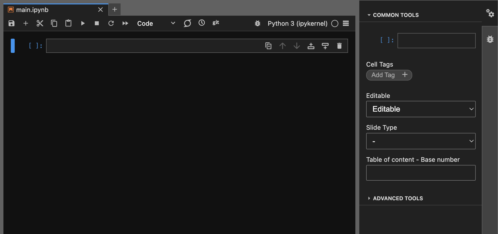
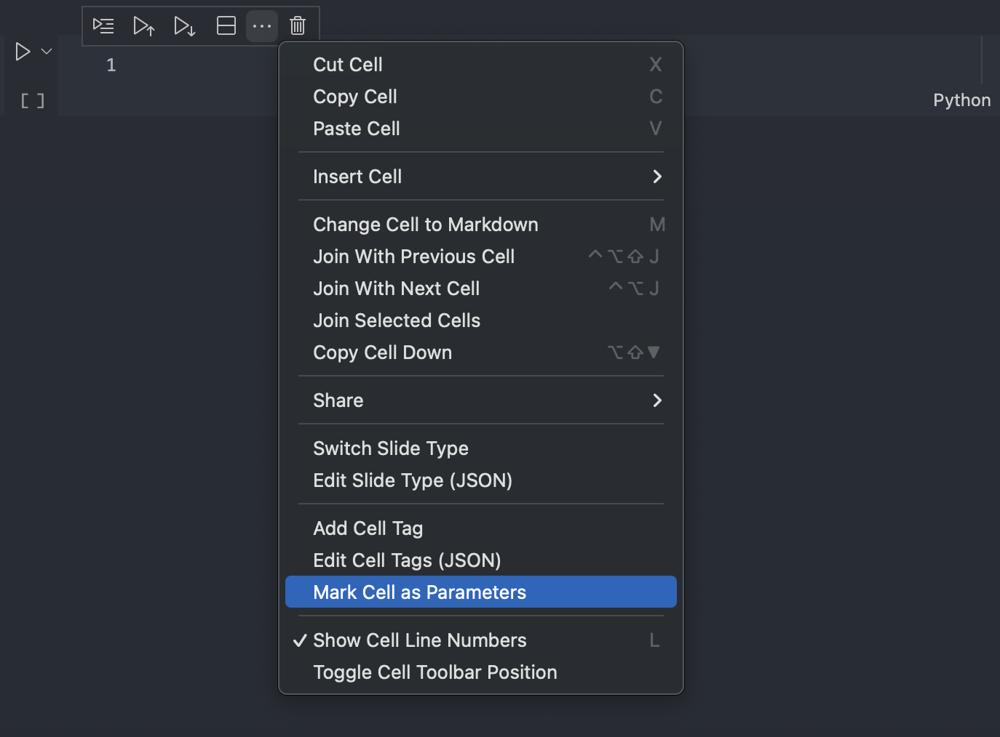

# Working with notebooks

While working on a research project,
Jupyter notebooks can be useful for prototyping and data exploration.
If while working interactively in a notebook
you get an output you like, e.g., a figure,
it can be tempting to simply stop right there
and copy/paste it into a research article.
However, in order to keep the project reproducible,
we need to be able to go from raw data to research article
[with a single command](https://doi.org/10.1190/1.1822162),
which of course is not possible in the above scenario.

This is the primary notebook use case Calkit is concerned with:
generating evidence to back up conclusions or answers to research questions.
There are other use cases that are out of scope like using notebooks to build
documentation or interactive web apps for exploring results.
For building [apps](apps.md) (a different concept in a Calkit project),
there are probably better tools out there, e.g.,
[marimo](https://marimo.io/),
[Dash](https://dash.plotly.com/),
[Voila](https://voila.readthedocs.io/en/stable/),
or [Gradio](https://www.gradio.app/).

Here we'll talk about how to take advantage of the interactive nature
of Jupyter notebooks while incorporating them into a reproducible workflow,
avoiding some of the pitfalls that have caused a bit of a
[notebook reproducibility crisis](https://leomurta.github.io/papers/pimentel2019a.pdf).
Returning to the "one project, one command" requirement,
we can focus on three rules:

1. The notebook must be kept in version control.
   This happens naturally since any file included in a Calkit project is
   kept in version control.
   However, it's usually a good idea to exclude notebook output from
   Git commits.
   This can be done by installing `nbstripout` and running
   `nbstripout --install` in the project directory.
   Note that the notebooks Calkit generates as pipeline outputs (those under
   `.calkit/notebooks`) are exempted from stripping automatically when the
   pipeline is compiled, since their outputs are the pipeline's results and
   stripping them would commit content that doesn't match what DVC hashed.
1. A notebook must run in one of the project's [environments](environments.md).
1. Notebooks should be incorporated into the project's
   [pipeline](pipeline/index.md).
   It's fine to do some ad hoc work interactively to get the notebook
   working properly, but
   "official" outputs should be generated by calling `calkit run`.
   This means notebooks need to be able to run from top-to-bottom with no
   manual intervention. We'll see how below.

If you use JupyterLab, check out the
[Calkit JupyterLab extension docs](jupyterlab.md).

## Creating an environment for a notebook

Assuming you want to run Python in the notebook, you can create an environment
for it with `uv`, `venv`, `conda`, or `pixi`.
For example, if we wanted to create a new `uv-venv` called `py` in our project,
we can execute:

```sh
calkit new uv-venv \
    --name py \
    --prefix .venv \
    --python 3.13 \
    --path requirements.txt \
    jupyter \
    "pandas>=2" \
    numpy \
    plotly \
    matplotlib \
    polars
```

You can then start JupyterLab in this environment with
`calkit xenv -n py jupyter lab`.

Note the environment only needs to be created once per project.
If the project is cloned onto a new machine,
the environment does not need to be recreated,
since that will be done automatically when the project is run.
Also note that it's totally fine and perhaps even preferable to create
a new environment for each notebook, so long as they have different
names, prefixes, and paths---there is no limit to the number
of environments a project can use, and they can be of any type.

## Adding a notebook to the pipeline

A notebook can be added to the pipeline either with
`calkit new jupyter-notebook-stage` or
by editing the project's `calkit.yaml`
file directly.
For example:

```yaml
# In calkit.yaml
environments:
  py:
    kind: uv-venv
    prefix: .venv
    python: "3.13"
    path: requirements.txt
pipeline:
  stages:
    my-notebook:
      kind: jupyter-notebook
      environment: py
      notebook_path: notebooks/get-data.ipynb
      inputs:
        - config/my-params.json
      outputs:
        - data/raw/data.csv
      html_storage: dvc
      executed_ipynb_storage: null
      cleaned_ipynb_storage: git
# Optional: Add to project notebooks so they can be viewed on the hub
notebooks:
  - path: notebooks/get-data.ipynb
    title: Get data
    stage: my-notebook
```

For this example, we're declaring that the notebook
should use the `py` environment, and that it will read an input
file `config/my-params.json` and produce an output
file `data/raw/data.csv`.
These inputs and outputs will be tracked
along with the notebook and environment content,
to automatically determine if and when the notebook needs to be rerun.
Outputs will also be kept in DVC by default so others can pull them down
without bloating the Git repo.
Output storage is configurable, however, e.g., if you'd like to keep
smaller and/or text-based outputs in Git for simplicity's sake.

Copies of the notebook with and without outputs will be generated as the
notebook is executed, along with an HTML export of the latter.
Storage for these outputs can be controlled with the `html_storage`,
`executed_ipynb_storage`, `cleaned_ipynb_storage` properties,
and they will live inside the project's `.calkit` subdirectory.
The executed `.ipynb` can be rendered on GitHub or
[nbviewer.org](https://nbviewer.org),
and the HTML can be viewed on [calkit.io](https://calkit.io),
the latter of which allows some level of interactivity, e.g., Plotly figures.
The cleaned `.ipynb` can be useful for diffing with Git in cases where
`nbstripout` is not activated.

It's also possible to add a notebook to the pipeline
inside a notebook with the `declare_notebook` function,
which will update `calkit.yaml` automatically.

```python
import calkit

calkit.declare_notebook(
    path="notebooks/get-data.ipynb",
    stage_name="my-notebook",
    environment_name="py",
    inputs=["config/my-params.json"],
    outputs=["data/raw/data.csv"],
    html_storage="dvc",
    executed_ipynb_storage=None,
    cleaned_ipynb_storage="git",
)
```

Note that for this to run properly `calkit-python` must be installed in
the notebook's environment, which in this case is named `py` and whose
packages are listed in `requirements.txt`.
If we didn't include them when creating the environment,
we can simply add `calkit-python` to the `requirements.txt` file and rerun
`calkit xenv -n py jupyter lab`.
The environment will be updated before starting JupyterLab.

<!-- TODO: needs human review -->

## Saving values, figures, and tables from cells

Usually, to get a number or figure from a notebook into a paper,
the notebook needs to write it to a file,
and the paper needs to read that file.
With Calkit, you can skip the first part.
Pick a value, figure, or table that a cell makes,
and Calkit will save it every time the pipeline runs the notebook.

There are three kinds of outputs:

- **Value:** A number, string, or list or dict of them, up to 100 kB,
  e.g., a fitted constant.
  You can cite it in a LaTeX document with
  `\ckvalue{notebook.ipynb}{name}`,
  in Quarto with ``,
  or in Markdown with `<!-- ckvalue notebook.ipynb name -->`.
  To get a single item out of a dict, use a dot, e.g., `rates.25C`.
- **Figure:** A figure the cell displays, or a Matplotlib figure in a
  variable.
  It's saved in the format of the path you give it,
  so use `.pdf` if you want it sharp in a paper.
- **Table:** A DataFrame, a list of rows,
  or whatever the cell displays, e.g., `df.head()` on its last line.
  It can be saved as LaTeX (`.tex`, for `\cktable`), CSV, Markdown, or JSON.

In VS Code or JupyterLab, click **Save as Calkit Output**
in the cell's toolbar.
The cell will then show a label like `Calkit: k_25 = 0.0309`.
Click the label to copy the command that cites it,
insert it into one of the project's documents,
edit it, or stop saving it.

From the command line (or for an agent), use `calkit nb add-output`.
To save multiple values from the same cell,
pass `--variable-name` once for each:

```sh
calkit nb add-output fit-rates.ipynb value --cell-id 3f9a1c2e \
    --variable-name k_25 --variable-name k_35
calkit nb add-output fit-rates.ipynb figure --cell-id 8b77d0aa \
    --variable-name fig --output-path figures/decay.pdf
calkit nb add-output fit-rates.ipynb table --cell-id 1d2e4c0b \
    --variable-name rates_df --output-path tables/rates.tex --format .3f
calkit nb outputs fit-rates.ipynb
```

`calkit nb remove-output` stops saving one.

Outputs are stored with the notebook's stage in `calkit.yaml`,
and point to cells by their IDs,
so they follow a cell if you move it:

```yaml
pipeline:
  stages:
    fit-rates:
      kind: jupyter-notebook
      notebook_path: fit-rates.ipynb
      environment: py
      cell_outputs:
        - kind: value
          cell_id: 3f9a1c2e
          variable_names: [k_25, k_35]
        - kind: figure
          cell_id: 8b77d0aa
          variable_name: fig
          output_path: figures/decay.pdf
        - kind: table
          cell_id: 1d2e4c0b
          variable_name: rates_df
          output_path: tables/rates.tex
          format: .3f
```

Use `variable_name` for a single value.
With `variable_names`, each value is still cited by its own name,
e.g., `\ckvalue{fit-rates.ipynb}{k_35}`.

A value is saved right after its cell runs,
so if a later cell changes the variable,
you still get the value from that cell.
Values go in a JSON file for the notebook, e.g.,
`.calkit/notebooks/outputs/fit.ipynb/values.json`.
Figures and tables go wherever their paths say.
They're all outputs of the stage,
so the pipeline knows when they're out of date.
Note that running the notebook by hand doesn't save them.
What a document shows always comes from a pipeline run.
If an output can't be saved, e.g., because a variable was renamed,
the run will stop and tell you which cell and variable.

On Overleaf, if the browser extension is connected to Calkit on your
machine, it can find numbers in the paper that a notebook printed.
Click **Use this** in the Calkit card to save the variable as an output,
then **Run and sync**.
After that, the card can replace the typed number with a `\ckvalue`.

You can still write results files from the notebook, e.g., with
`json.dump`, if you'd like it to work without Calkit.
Just list those files in the stage's `outputs`.

<!-- prettier-ignore -->
!!! note
    Cell IDs need to stay the same for this to work.
    `nbstripout` renumbers them unless it's installed with `--keep-id`.
    `calkit nb add-output` will warn you if a notebook's IDs look
    renumbered.

## Working interactively

The main advantage of Jupyter notebooks is the ability to work interactively,
allowing us to quickly iterate on a smaller chunk of the process
while the rest remains constant.
For example, if you need to refine a figure,
you can keep updating and running the cell that generates the figure,
without needing to rerun the expensive cell above that generates
or processes the data for it.
In this case our notebook might look like this:

```python
from some_package import run_data_processing

result = run_data_processing(param1=55)
```

```python
import matplotlib.pyplot as plt

fig, ax = plt.subplots()
ax.plot(result["x"], result["y"])
```

```python
fig.savefig("figures/my-plot.png")
```

So, with a fresh Jupyter kernel we'll need to run cell 1 in order to generate
`result` so we can iterate on cell 2 to get the plot looking the way
we want it to.
But what if `run_data_processing`
takes minutes, hours, or even days, so therefore we don't want to run it
every time we restart the notebook?
Well, we can use the Calkit `%%stage` cell magic to automatically cache
and retrieve the result.

After adding a cell with:

```python
%load_ext calkit.magics
```

the first cell can be turned into a pipeline stage by changing it to:

```python
%%stage --name run-nb-proc --environment py --out result

from some_package import run_data_processing

result = run_data_processing(param1=55)
```

In the magic command we're giving the cell a unique name,
declaring which environment it should run in
(`py` above, but it can be any environment in the project),
and declaring an output from the cell that we want to be available to
cells below.

Now, the kernel can be restarted and we can use "run all cells above"
when working on the figure,
and we'll have `result` nearly instantaneously.
`result` will also be versioned with DVC and pushed to the hub by default,
so our collaborators can also take advantage of the caching
without bloating the Git repo.
Execution as part of the project's pipeline will also take advantage of
the caching and will not rerun data processing unless something
about that cell's code or environment has changed.

For a more in-depth look at using the `%%stage` cell magic,
see [this tutorial](tutorials/notebook-pipeline.md).

## Parameterizing notebooks

Thanks to [Papermill](https://github.com/nteract/papermill),
Calkit can run notebooks that have been parameterized,
and executed versions will be saved with parameters in their names.
To parameterize a notebook,
first add a cell with the "parameters" tag and add your parameters there
as variable declarations, e.g.,

```python
param1 = 5
param2 = "something"
```

In JupyterLab, you can use the property inspector to edit cell tags:



In VS Code, the cell context menu can be used to mark the cell as parameters:



Then, in the Calkit pipeline, add `parameters` to the notebook stage:

```yaml
# In calkit.yaml
environments:
  main:
    kind: uv-venv
    path: requirements.txt
    prefix: .venv
    python: "3.13"
pipeline:
  stages:
    notebook-56-a:
      kind: jupyter-notebook
      notebook_path: notebook.ipynb
      environment: main
      parameters:
        param1: 56
        param2: a
    notebook-58-b:
      kind: jupyter-notebook
      notebook_path: notebook.ipynb
      environment: main
      parameters:
        param1: 58
        param2: b
```

### Iterating over parameterized notebooks

The example below shows project-level parameters used to iterate over a
notebook stage:

```yaml
parameters:
  param1:
    - kind: range
      start: 0
      stop: 10
      step: 2
  param2:
    - random-forest
    - lightgbm
pipeline:
  stages:
    my-notebook-with-params:
      kind: jupyter-notebook
      environment: my-env
      notebook_path: notebook.ipynb
      iterate_over:
        - arg_name: param1
          values:
            - parameter: param1 # Args and params can be named differently
        - arg_name: param2
          values:
            - parameter: param2
      parameters:
        param1: "{param1}" # Notebook params can also be named differently
        param2: "{param2}"
      outputs:
        - results/param1={param1}/param2={param2}/results.csv
```

For more information, see [pipeline iteration](pipeline/index.md#iteration).
