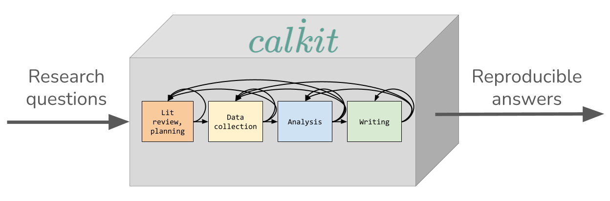

# _Calkit_: The cure for [_reproducibility anxiety_]{.highlight} in the age of AI

**Calkit is an open-source framework and platform that keeps figures,
tables, and values in research articles connected to the code and data
that calculated them, for fast iteration and full _observability_.**

<!-- calkit values path=results/traction.json -->

## By the numbers

- **<!-- calkit value key=hub_users -->137<!-- /calkit value -->**
  users on calkit.io
- **<!-- calkit value key=pypi_downloads_last_month format="{:,.0f}" -->3,616<!-- /calkit value -->**
  downloads from PyPI last month
- **<!-- calkit value key=papers_shipped -->5<!-- /calkit value -->**
  reproducible publications shipped

As of <!-- calkit value key=date -->2026-10-20<!-- /calkit value -->.

## The problem

- [TODO: AI makes results cheap to produce and easy to get wrong,
  so verification is now the bottleneck]
- [TODO: We need to see how an agent calculated something,
  just as we need to see how we did]
- The publisher PLOS found
  [only 12% of articles sharing code](https://doi.org/10.1371/journal.pone.0311493),
  and less of what's shared actually runs
- [TODO: Reproducibility anxiety is justified but rare,
  e.g., Becca's near miss below]

## Our approach

- **Silos:** [TODO: separate tools glued together by hand,
  e.g., screenshots pasted into Overleaf]
- **Monoliths:** [TODO: literate programming and notebooks
  put everything in one context]
- **Calkit:** [TODO: modular but connected, one context at a time]
- [TODO: Humans and AI agents verify each other's work]

## A sample success story {.box}

[Rebecca (Becca) McCabe](https://scholar.google.com/citations?user=r3eP1gIAAAAJ&hl=en)
[TODO: who she is and what success meant]

- MATLAB, Python, Julia, and LaTeX in single-button reproducible pipelines
- 3 journal articles submitted, with collaborators contributing through
  Overleaf instead of Git
- [TODO: the workshop she ran]

> In the first conference paper I wrote back in 2022,
> I had a scare where my process of manually screenshotting MATLAB figures and uploading them to Overleaf
> almost led me to publish inconsistent results when I forgot to rerun some intermediate steps.
> To ensure the integrity of my research, I resolved to better automate my workflow,
> and spent too much time creating some clunky one-off reproducibility code that only partially addressed my needs.
> Then in 2025 I stumbled upon Calkit.
> With its structured approach, cross-language capabilities, and use of software engineering best practices,
> Calkit was more comprehensive, flexible, and future-proof than my hacky custom script, and
> I relied on it heavily for the remainder of my projects.
> Using Calkit significantly **relieved my anxiety** about inadvertently contributing to the replication crisis;
> streamlined review, collaboration, and reproduction workflows that would have been otherwise infeasible;
> and improved the usability and visibility of my work for other researchers.
> Importantly, Calkit scales to more complex projects, and I can't imagine how I would have
> kept the 87 figures and 92 numerical results in my dissertation straight without this tool.
> I also received impressive technical support, including fast and helpful responses to my questions, bug reports, and feature requests.
> I would recommend Calkit to software-savvy researchers (and even tech-traditionalist collaborators)
> who care about the accuracy and transparency of their results.

<!-- calkit values path=results/2027-budget.json -->

## The ask: \$<!-- calkit value key=total_rounded format="{:,.0f}" -->100,000<!-- /calkit value --> to take Calkit on tour

[TODO: A year of workshops on reproducibility and on getting AI agents to
work transparently and observably]

- <!-- calkit value key=workshops -->8<!-- /calkit value --> workshops
  training about
  <!-- calkit value key=researchers_trained -->200<!-- /calkit value -->
  researchers
- <!-- calkit value key=projects_supported -->60<!-- /calkit value -->
  researchers supported converting their active projects
- [TODO: What others can reuse, e.g., an open curriculum]

## Team and support

[TODO: Pete; 25% of a Caltech Schmidt Academy RSE; Google Cloud credits]

::: footer
Learn more at [docs.calkit.org](https://docs.calkit.org) and
[calkit.io](https://calkit.io), or email Pete Bachant at
[pete@calkit.org](mailto:pete@calkit.org).
:::
